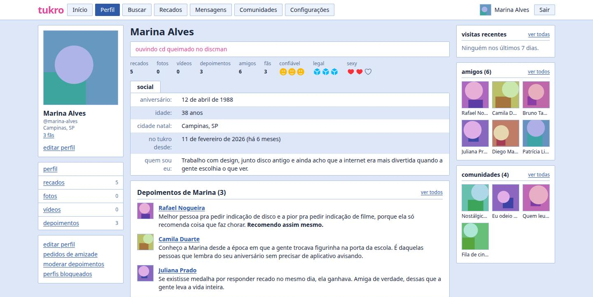
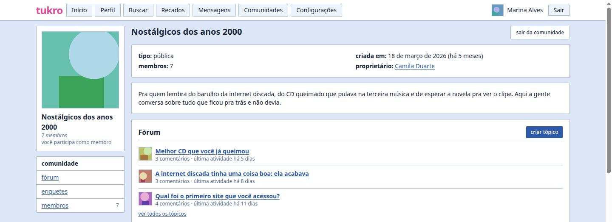

# Tukro

Rede social com cara de começo dos anos 2000: perfil, recados, depoimentos, amigos e
comunidades com fórum. Sem feed adivinhando o que você quer ver, sem métrica de
engajamento decidindo quem some, sem anúncio e sem rastreador.

Este repositório é o frontend.

## Aviso

O Tukro não tem vínculo com o Orkut nem com o Google. É um projeto pessoal, feito por
diversão, que se inspira em como aquela internet funcionava. Orkut é marca de terceiros e
não aparece aqui como nome de produto, só como referência ao que inspirou.

## Telas

O perfil, com recados, depoimentos, amigos, comunidades e as três avaliações:



Uma comunidade e o fórum dela:



Os perfis e as comunidades das imagens são fictícios, criados só para a demonstração.

## O que está aberto

Só o frontend. O backend é fechado e continua assim: ele guarda dado de gente de verdade,
e abrir a implementação de autenticação, moderação e privacidade de um serviço em
produção não me parece uma boa ideia.

Na prática, o contrato da API é o limite deste repositório. Os tipos em `src/lib/types/`
espelham o que o backend responde, e cada módulo de `src/lib/` conversa com um pedaço da
API.

## Backend

O backend é fechado, mas quem contribui tem um ambiente de staging: um backend real, com
dados de demonstração, contra o qual o front funciona de ponta a ponta.

No staging a API roda inteira, com duas travas:

- Upload de arquivo desligado. Avatar de pessoa, avatar de comunidade e mídia de álbum
  respondem `403`, para ninguém pendurar arquivo estranho no domínio.
- Cadastro e e-mail desligados. `register`, `forgot-password` e reenvio de verificação
  também respondem `403`. Os usuários existem porque eu criei, não porque alguém se
  registrou.

O resto, que é texto, funciona normal: recado, depoimento, tópico de fórum, comentário,
pedido de amizade, avaliação, enquete, mensagem. Um script meu reseta o banco todo dia e
recria os usuários da whitelist, então bagunça não acumula e seu login volta ao estado
inicial de manhã.

A URL do staging e o seu login não estão neste repositório. Fale comigo primeiro, pelo
processo do [CONTRIBUTING.md](CONTRIBUTING.md): a gente combina o que você vai mexer na
issue e eu te passo o endereço e as credenciais. Sem isso, o `.env.example` aponta para
`http://localhost:8001`, que só existe na minha máquina, e o front trava na tela de
login.

## Stack

- [SvelteKit](https://svelte.dev/docs/kit) em modo SPA, com `adapter-static`
- [Svelte 5](https://svelte.dev/docs/svelte) com runes, sem stores
- [Tailwind CSS 4](https://tailwindcss.com)
- TypeScript
- [Bun](https://bun.sh) para instalar e rodar

Uma dependência de runtime, o `svelte-sonner`, para os avisos de canto de tela.

## Rodando

```sh
bun install
cp .env.example .env
bun run dev
```

O `.env` tem duas variáveis:

| Variável              | Para que serve                             |
| --------------------- | ------------------------------------------ |
| `PUBLIC_API_BASE_URL` | Endereço base do backend, sem barra no fim |
| `PUBLIC_ENV`          | Ambiente atual, `dev` ou `prod`            |

Leia a seção Backend acima antes de esperar que a aplicação funcione inteira.

### Build de produção

As duas variáveis são `static` (veja `src/env.ts`), então o valor é **embutido no
bundle na hora do build**, não lido em tempo de execução. Buildar com o `.env` de
desenvolvimento gera um site apontando para `http://localhost:8001`.

Antes de `bun run build`, crie um `.env.production`, que o Vite carrega sozinho no
modo de produção:

```sh
PUBLIC_API_BASE_URL=https://api.tukro.app
PUBLIC_ENV=prod
```

O resultado sai em `build/`, que é o diretório estático a servir no Nginx.

## Scripts

| Comando           | O que faz                                     |
| ----------------- | --------------------------------------------- |
| `bun run dev`     | Sobe o servidor de desenvolvimento            |
| `bun run build`   | Gera o site estático em `build/`              |
| `bun run preview` | Serve o que foi gerado pelo build             |
| `bun run check`   | Roda o `svelte-check` sobre o projeto inteiro |
| `bun run lint`    | Confere a formatação com o Prettier           |
| `bun run format`  | Aplica a formatação                           |

## Estrutura

```
src/
  app.html            Casca da página, com a splash de boot e o tema inicial
  env.ts              Declaração das variáveis de ambiente
  lib/
    api.ts            Cliente HTTP: token, timeout, envelope de erro
    error.ts          ApiError, que espelha o formato de erro do backend
    <domínio>.ts      Um módulo por área: friend, community, topic, scrap...
    components/       Componentes compartilhados entre as telas
    state/            Estado global em runes: sessão, tema, suspensão
    types/            Tipos que espelham o contrato da API
  routes/
    @[slug]/          Perfil, mural, álbum, amigos e depoimentos
    community/        Comunidades, membros, pedidos e fórum
    admin/            Fila de denúncias, só para quem é superusuário
```

A aplicação tem quatro temas, dois retrô e dois modernos, cada um em claro e escuro. As
cores vivem como variáveis CSS em `src/routes/layout.css`.

## Contribuindo

Leia o [CONTRIBUTING.md](CONTRIBUTING.md). O resumo é: abra uma issue antes de mandar
código.

## Licença

[MIT](LICENSE).
